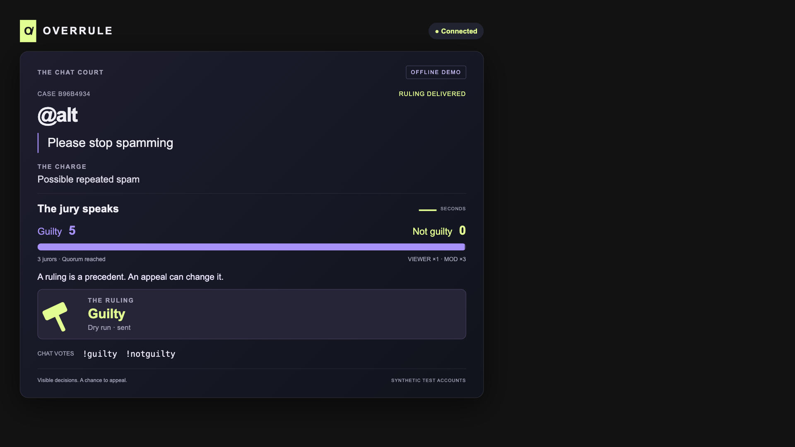

# Overrule

A moderation court for Twitch chat, with visible votes, streamer review and an appeal record.

Built from an empty repository with OpenAI Codex for the Codex x TwitchCon Hackathon.
The build supports offline fixtures and a separate Twitch live mode.
OAuth, EventSub and Helix have passed local mock tests.
**No real Twitch timeout or real-channel connection has been verified.**



## Try the offline demo

Use Node.js 22.18 or later in the Node 22 line.
No Twitch account or model key is needed for the simulator.
Clone this repository, enter its folder and run the following command.

```sh
npm ci --ignore-scripts
npm run sim
```

Open [the overlay](http://localhost:3000/overlay).
The first connected page starts the fixture.
It shows one case, three synthetic jurors, a 25-second vote, a simulated approval and a gavel.
The server stays open. Stop it with Ctrl+C.
Run only one server at a time.

For OBS, use the overlay URL as a browser source at 1920 by 1080.
The background is transparent. The browser layout has been checked at that size.
An actual OBS and Twitch stream rehearsal is still needed.

## Run modes

| Mode | Command or entry point | Behavior |
| --- | --- | --- |
| Automatic demo | `npm run sim` | Fixture starts when a page connects. Approval is synthetic. Actions are dry runs |
| Manual court | `npm run dev` | Start the fixture on the operator page. A key press is required for the ruling |
| Missing model key | `OPENAI_API_KEY= MODEL_ENABLED=1 npm run sim` | The loop uses deterministic advice |
| Fake Helix tests | `npm test` | Tests send HTTP requests to a local fake server |
| Twitch chat with dry run actions | `npm run live` | Authorize the broadcaster account. Read live chat but send no moderation actions |
| Twitch with real actions | `DRY_RUN=0 OVERRULE_LIVE_ACTIONS=1 npm run live` | Explicit owner opt-in. Operator approval is required |

Setting DRY_RUN=0 still stops the fixture modes.
Live mode requires both action flags before it sends Helix actions.
AUTO_ACTIONS does not enable real moderation.

## Pages and controls

| Page | Purpose |
| --- | --- |
| [Overlay](http://localhost:3000/overlay) | Case card, weighted votes, countdown and gavel |
| [Operator](http://localhost:3000/operator) | Fixture start, keys and appeal review |
| [Docket](http://localhost:3000/docket) | Cases, public votes, action status, precedent and consistency |
| [Case data](http://localhost:3000/cases) | Current JSON snapshot |

The root page opens the operator desk.
The server binds to loopback on port 3000.
SSE sends full snapshots and reconnects automatically.
The gavel does not repeat when the same ruling reconnects or reloads.

In manual mode, select Start fixture and keep the operator page focused.

| Key | Action |
| --- | --- |
| Space | Close voting early |
| A | Approve the jury result |
| V | Veto the action |
| G | Explicitly approve a guilty timeout |

With no jury result, A does nothing and shows a message to use G for an explicit timeout.
Veto wins if A and V arrive within the 300 millisecond decision window.
During the appeal window, select Simulate accused appeal, then Uphold ruling or Overturn ruling.
That button is a dry run stand-in for the accused. A mod or the broadcaster can file `!appeal @login` for a timed-out user. A timed-out user cannot send chat.
A new fixture can start after the current case closes.

## Case rules

- One active case in the court.
- Shared chat guests cannot be tried or vote. Source room and source badges preserve guest broadcaster and moderator roles.
- Guest messages are excluded from evidence, reports and commands.
- Broadcaster and moderator immunity, including lead moderators. Staff, admin and global moderator badges are also immune. VIP immunity is on unless VIP_IMMUNITY=0 in live mode.
- Viewer reports enter a private operator queue. Only operator promotion opens the case.
- Evidence stays hidden in public snapshots until the operator selects Reveal evidence on stream.
- Message deletion and user chat clearing remove cached and displayed evidence.
- An attempted ruling on deleted evidence becomes expired with no timeout.
- Do not delete the target message during the timeout demonstration. See the [owner test script](docs/owner-test.md).
- SUBSCRIBER_VOTES_ONLY=1 in live mode limits viewer votes to subscribers. Mods and the broadcaster remain eligible.
- Automatic approval cannot use live Helix.
- One vote per user. A changed vote replaces the earlier vote.
- Viewer weight one. Mod and broadcaster weight three.
- No vote from the accused in their own case.
- Three distinct jurors are required. A tie has no jury result.
- More than 40 new voters in ten seconds marks the vote as contested.
- Manual mode requires streamer approval. Model advice never authorizes an action.
- Timeout requests are capped at 600 seconds. New cases need evidence no more than two minutes old.
- Approval expires five minutes after case opening. The operator shows the remaining time.
- Expiry records a separate state and posts Ruling expired. No action.
- No permanent ban or message deletion action.
- One appeal per stream ID, with a two-minute request window. Offline mode creates a stream ID for each process. Live mode groups appeals by broadcaster and UTC date, not by Twitch broadcast ID.

The parser supports `!case @login reason`, `!report message-id reason`, reply reports, `!guilty`, `!notguilty`, `!vote guilty`, `!appeal` and `!docket`.
Reply reports accept the parent mention that Twitch adds. Reports wait for operator promotion.
A reply-based !case uses the parent message. An optional @login must match its author. Other !case commands require @login.
The parser allows five commands per user in ten seconds.
Only npm run live connects to Twitch. Fixture modes remain offline.

## Actions, appeals and precedent

The Helix interface has a default dry run client and an HTTP client.
Tests cover timeout, verdict chat and owned-timeout removal against a local fake server.
The HTTP client checks response status and chat delivery status.

The journal records an action before the request starts.
It then records sent, failed or unknown status with the adapter mode.
Sent in dry run mode means only that a local simulation completed.
Fake mode means the local fake server accepted the request.
Neither is proof of a Twitch action.

HTTP requests have a four-second deadline. Live requests retry once after a 401 token refresh. Other writes are not retried automatically.
A saved pending action becomes unknown after restart and is not sent again.
An owner must check the channel before any manual recovery.
There is no recovery button yet.
Helix waits at most four seconds for authorization before recording Not sent. Authorization unavailable.
A later token recovery cannot send that failed action.

An overturn changes the final precedent and requests removal of the owned timeout.
The HTTP client compares the current timeout with its saved receipt first.
It refuses to remove a changed timeout or permanent ban.
The docket shows the ruling and release result separately.

Consistency is the share of closed case pairs with the same rule and the same final verdict.
An overturn changes that final verdict. There is no score when no comparable pair exists.
The score is a record of agreement, not a claim that a ruling was correct.

## Model advice and fallback

The default is deterministic and needs no key.
Simple rule keywords choose neutral charge text and a matching closed precedent.
The optional model writes charge text and selects from supplied precedent IDs.
It cannot change the rule, verdict, vote weight or timeout duration.

To enable it later, set MODEL_ENABLED=1, OPENAI_MODEL and OPENAI_API_KEY in the process environment.
Use a model that supports strict structured output for Chat Completions.
Never put a key in this repository.
The request sends the reported text, reason, rule and selected precedent records to the model service.

Fallback advice appears at once. Voting does not wait for the model.
Each model attempt has a four-second deadline. There is at most one retry.
Missing keys, refusals, invalid output and service errors keep the fallback.
Invented precedent IDs are rejected.
No paid model call was made during the recorded build. The live model path has not been verified.

## Twitch app setup

These steps prepare the separate live mode. Use a broadcaster test account.

1. Enable two-factor authentication in [Twitch security settings](https://www.twitch.tv/settings/security) if needed.
2. Open the [developer console](https://dev.twitch.tv/console/apps) and register an app.
3. Use Overrule as the name if available. Select Chat Bot as the category.
4. Add `http://localhost:3000/auth/callback` as the OAuth redirect URL.
5. Save the client ID and secret to `~/yc-w27-work/.secrets/twitch-app.json` using the shape below.

```json
{
  "client_id": "REPLACE_LOCALLY",
  "client_secret": "REPLACE_LOCALLY",
  "redirect_uri": "http://localhost:3000/auth/callback"
}
```

Protect the external folder and file after saving them.

```sh
chmod 700 ~/yc-w27-work/.secrets
chmod 600 ~/yc-w27-work/.secrets/twitch-app.json
```

The loader handles an absent file without exposing credentials.
Imports, tests and the default runtime do not read it.
The live entry point reads it only when invoked. An absent file stops live startup.
The client secret is not a user access token.

The user-token scopes are `user:read:chat`, `user:write:chat` and `moderator:manage:banned_users`.
The current live Helix factory requires matching broadcaster and moderator IDs for its timeout ownership check.
Verdicts post as the broadcaster. A separate bot identity is not supported.

Set OVERRULE_EXPECTED_LOGIN to the test channel login before each live run. It is required when real actions are enabled.
A mismatched saved login is ignored for startup. The terminal names both logins and opens the local authorization flow again.
A newly authorized account must match before the court starts.
OAuth forces account confirmation. The terminal prints Connected to channel followed by the validated login.
Run npm run live. If authorization is needed, open http://localhost:3000 and follow the Twitch link.
OAuth checks state and the browser cookie. Tokens stay in ~/.config/overrule/tokens.json with mode 600.
Tokens refresh before expiry and after a 401. Validation runs at startup and hourly.
EventSub subscribes to chat messages, message deletion, user chat clearing and full chat clearing.
It handles keepalives, reconnect transfer, connection loss, duplicate notifications and revocation.
OAuth retries network errors, timeouts, 429 and server errors with delays of 1, 2, 4 and 8 seconds, capped at 60 seconds.
Subscription failures reconnect with backoff and jitter. Successful connection resets the delay.
EventSub waits at most four seconds for token access or refresh. An unused socket close reconnects.
Authorization rejection still stops the live session. Temporary subscription outages keep the local court available.
OAuth startup requests can still wait indefinitely during an outage.
Fixtures cannot start in live mode.
First verify real chat with dry run actions. Then use the explicit action flags for an owner-approved test-account timeout and appeal removal.

## Tests and build evidence

The latest verification passed **86 tests** and the TypeScript check on 26 October 2026.
Local HTTP and WebSocket mocks cover OAuth refresh, hourly validation, reconnects, revocation and live Helix wiring.
These are repository mock servers. The Twitch CLI binary and real Twitch APIs were not run.
Safety tests cover role immunity, report triage, subscriber votes, evidence removal, private HTTP access, no-quorum decisions and the live automatic-action guard.

```sh
npm ci --ignore-scripts
npm run check
npm test
```

The runtime uses ws. Tests use the Node test runner and local mock servers.
Install the locked dependencies before running the app or tests.

Browser checks verified the 1080p vote loop, operator keys, SSE recovery, appeals and the docket.
The fake-server browser flow also passed with an empty model key.
The optional scripts use the sprint browser on CDP port 9252 and close their own tabs.

```sh
node scripts/verify-browser.mjs
node scripts/verify-operator.mjs
OPENAI_API_KEY= MODEL_ENABLED=1 OPENAI_MODEL=test-only node scripts/verify-day45.mjs
```

On the build Mac, run the following checks before an install, test or browser run.
Do not proceed below 20 GB available or 25 percent free memory.

```sh
df -g /System/Volumes/Data
memory_pressure | tail -1
```

See [the build log](docs/codex-log.md), [the docket screenshot](docs/screenshots/day45-docket.png) and the tests in test/.
The repository began empty. No TapVow source or package was used.

Codex session ID `01a17712-fe31-70e0-a11c-9b80e5183106`.

## Storage and limits

This is a local prototype. Use synthetic messages and test accounts.
It holds chat text on disk. Closing a case clears text from the current snapshot, but older audit records retain it.
The appeal-window text purge and 14-day retention tool are not implemented.

Each automatic demo process writes a fresh data/demo-*.jsonl journal.
Manual mode restores data/operator-audit.jsonl. Live mode restores data/live-audit.jsonl.
The private report queue is held in memory. It holds at most 20 reports and expires evidence after two minutes.
Deletion events clear current text. Historical audit lines still retain it.
Safety changes have unit and HTTP coverage. The revised pages still need an OBS rehearsal.
Writes are flushed before the memory index changes. Invalid or incomplete records stop startup.
Use one process per journal. There is no cross-process lock, compaction or journal size limit.
Long-session chat pacing and manual recovery still need work.

There is no hosted service, real-channel verification, OBS rehearsal or verified user-impact claim.
G2 and G3 passed offline. G5 passed with no model key.
G1 and G4 remain open for real Twitch chat and an approved real timeout.

## Owner finish steps

Complete Twitch 2FA and app registration if needed.
Authorize the broadcaster test account and verify real chat, timeout and moderator proxy appeal.
Run a short Twitch test stream and record the app functioning there.
Record the Codex build thread. The [public repository](https://github.com/theluckystrike/overrule) exists. Upload a public YouTube video under three minutes.
Complete the Devpost form, submit as an individual and save the confirmation.
No live Twitch rehearsal, video upload or Devpost submission has been completed by this build thread.

## References and license

The API adapters follow the [Twitch Helix reference](https://dev.twitch.tv/docs/api/reference/) and the [OpenAI structured output guide](https://developers.openai.com/api/docs/guides/structured-outputs).
Submission requirements are in the [official hackathon rules](https://twitchcon-codex.devpost.com/rules).

[MIT license](LICENSE).
